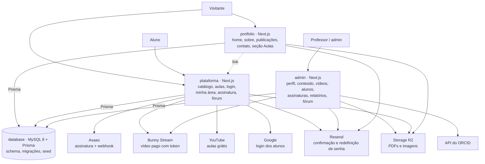

# 03 — Arquitetura

Quatro projetos: `database` define o banco, `admin` alimenta o banco, e
`portfolio` e `plataforma` exibem o conteúdo. Os apps nunca conversam entre
si; tudo passa pelo MySQL. Entre o portfólio e a plataforma há só links
comuns. O tema e os componentes visuais comuns aos dois sites ficam em
`packages/ui` (`@portfolio/ui`).

## Stack

| Camada | Escolha |
| --- | --- |
| Front-end (portfolio, plataforma e admin) | Next.js (App Router) + TypeScript + Tailwind CSS, ícones lucide-react |
| Acesso ao banco | Prisma ORM; schema mantido em `database/` e exportado como `@portfolio/database` |
| Banco | MySQL 8 (InnoDB, utf8mb4), gerenciado fora da Vercel |
| Validação | Zod |
| Sessão do admin | Cookie httpOnly com token aleatório; SHA-256 na tabela de sessões; senha com bcrypt |
| Login dos alunos | Better Auth (Google ou e-mail e senha): cookie assinado com HMAC (`BETTER_AUTH_SECRET`), tokens de confirmação e redefinição só em hash, até 2 sessões por aluno |
| Player | Bunny (iframe com token assinado) para vídeo pago; iframe do YouTube/Vimeo; `<video>` HTML5 para MP4 |
| PDF | Visualizador próprio (pdf.js) com marca d'água; arquivo servido por URL assinada de curta duração |
| Pagamento | API REST do Asaas (clientes, assinaturas, cobranças) + webhook |
| E-mail | Resend |
| Hospedagem | Vercel para os três apps (Hobby no desenvolvimento, Pro antes de cobrar) |
| Tarefas agendadas | Vercel Cron (aplicar trocas de disciplina, expirar assinaturas, limpar sessões) |

## Como o player escolhe a fonte

O componente `VideoPlayer` lê `videos.provider`:

| `origin` | `provider` | Player |
| --- | --- | --- |
| hosted | bunny | iframe do Bunny com URL assinada (2 h) + marca d'água |
| hosted | panda | iframe da Panda (alternativa futura) |
| external | youtube | iframe do YouTube (aulas grátis) |
| external | vimeo | iframe do Vimeo |
| external | mp4 | `<video>` HTML5 |

Trocar o provedor de um vídeo não exige mudar nenhuma página.

## Variáveis de ambiente

Cada projeto tem `.env.example` com a lista completa. Resumo:

| Variável | Usada em |
| --- | --- |
| `DATABASE_URL` | database (e, por meio do pacote `@portfolio/database`, nos três apps) |
| `BETTER_AUTH_SECRET` | plataforma, admin (o mesmo valor nos dois: o admin envia o convite e a redefinição de senha dos alunos) |
| `BETTER_AUTH_URL` | plataforma |
| `GOOGLE_CLIENT_ID`, `GOOGLE_CLIENT_SECRET` | plataforma (sem eles, o botão do Google fica escondido) |
| `RESEND_API_KEY`, `MAIL_FROM` | admin, portfolio, plataforma (sem a chave, os e-mails aparecem no terminal em desenvolvimento) |
| `STORAGE_*` | admin (envio), plataforma (visualizador de PDF, fase 4) |
| `BUNNY_LIBRARY_ID`, `BUNNY_API_KEY` | admin |
| `BUNNY_LIBRARY_ID`, `BUNNY_TOKEN_KEY` | plataforma (fase 4) |
| `ASAAS_API_KEY`, `ASAAS_API_URL` | admin, plataforma (fase 4) |
| `ASAAS_WEBHOOK_TOKEN`, `CRON_SECRET` | plataforma (fase 4) |
| `ORCID_ID` | admin |
| `SESSION_SECRET` | admin (reservada; a sessão do admin não depende dela hoje) |
| `ADMIN_URL`, `PLATAFORMA_URL` | admin |
| `NEXT_PUBLIC_SITE_URL` | portfolio, plataforma (endereço do próprio site) |
| `NEXT_PUBLIC_PLATAFORMA_URL` | portfolio (links para a plataforma; vazia = página "Aulas em desenvolvimento") |
| `NEXT_PUBLIC_PORTFOLIO_URL` | plataforma (links para o portfólio) |
