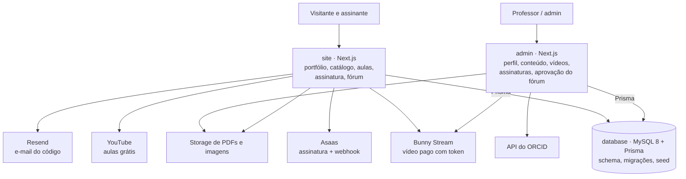

# 03 — Arquitetura

Três projetos: `database` define o banco, `admin` alimenta o banco e `site`
exibe o conteúdo. Os dois apps nunca conversam entre si; tudo passa pelo
MySQL.

## Stack

| Camada | Escolha |
| --- | --- |
| Front-end (site e admin) | Next.js (App Router) + TypeScript + Tailwind CSS, ícones lucide-react |
| Acesso ao banco | Prisma ORM; schema mantido em `database/` e exportado como `@portfolio/database` |
| Banco | MySQL 8 (InnoDB, utf8mb4), gerenciado fora da Vercel |
| Validação | Zod |
| Sessão | Cookie httpOnly com token aleatório; hash na tabela de sessões; senha do admin com bcrypt |
| Player | Bunny (iframe com token assinado) para vídeo pago; iframe do YouTube/Vimeo; `<video>` HTML5 para MP4 |
| PDF | Visualizador próprio (pdf.js) com marca d'água; arquivo servido por URL assinada de curta duração |
| Pagamento | API REST do Asaas (clientes, assinaturas, cobranças) + webhook |
| E-mail | Resend |
| Hospedagem | Vercel (Hobby no desenvolvimento, Pro antes de cobrar) |
| Tarefas agendadas | Vercel Cron (aplicar trocas de disciplina, expirar assinaturas, limpar sessões) |

## Como o player escolhe a fonte

O componente `VideoPlayer` lê `videos.provider`:

| `origin` | `provider` | Player |
| --- | --- | --- |
| hosted | bunny | iframe do Bunny com URL assinada (2 h) + marca d'água |
| hosted | panda | iframe da Panda (alternativa futura) |
| external | youtube | iframe do YouTube (aulas grátis) |
| external | vimeo | iframe do Vimeo |
| external | mp4 | `<video>` HTML5 |

Trocar o provedor de um vídeo não exige mudar nenhuma página.

## Variáveis de ambiente

Cada projeto tem `.env.example` com a lista completa. Resumo:

| Variável | Usada em |
| --- | --- |
| `DATABASE_URL` | database, admin, site |
| `ASAAS_API_KEY`, `ASAAS_API_URL`, `ASAAS_WEBHOOK_TOKEN` | site, admin |
| `BUNNY_LIBRARY_ID`, `BUNNY_API_KEY`, `BUNNY_TOKEN_KEY` | site, admin |
| `STORAGE_*` | site, admin |
| `RESEND_API_KEY`, `MAIL_FROM` | site, admin |
| `SESSION_SECRET` | site, admin |
| `ORCID_ID` | admin |
| `CRON_SECRET` | site |
