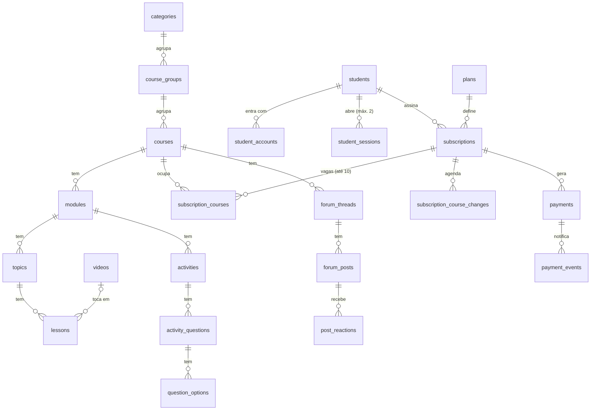

# 04 — Banco de dados (MySQL)

O banco tem **42 tabelas** em 11 blocos e uma visão. Os scripts ficam em
`database/sql/`:

| Arquivo | Conteúdo |
| --- | --- |
| `001_schema.sql` | Criação de todas as tabelas, chaves, índices, regras (CHECK) e a visão |
| `002_seed.sql` | Dados de exemplo: perfil, categorias, Física I completa, plano mensal e aluno de demonstração |

Os dois scripts foram executados e testados em MariaDB 10.11, compatível com
MySQL 8.0.16+.

## Hierarquias

- **Conteúdo:** categoria → grupo → disciplina → módulo → tema → aula → vídeo
  (ex.: Vestibulares → PSC (UFAM) → Física 1 → Cinemática → MRU → aula)
- **Acesso:** aluno → assinatura → vagas (as do plano, padrão 3, até 10; exceção por aluno)

## Garantias no próprio banco

| Regra | Como é garantida |
| --- | --- |
| No máximo 10 vagas por assinatura (o limite do plano ou do aluno é conferido no código) | `subscription_courses`: chave primária (assinatura, vaga) + CHECK vaga entre 1 e 10; CHECKs em `plans.max_courses` e `subscriptions.max_courses_override` (1 a 10) |
| Sem disciplina repetida na assinatura | Chave única (assinatura, disciplina) |
| Vídeo hospedado tem ID no provedor; link externo tem URL | CHECK `ck_videos_origin` |
| Material pertence a exatamente um dono (disciplina, módulo ou aula) | CHECK `ck_materials_one_owner` |
| Post e tópico têm um autor: aluno ou admin, nunca os dois | CHECK `ck_threads_author` e `ck_posts_author` |
| Webhook não é processado duas vezes | Chave única (gateway, event_id) em `payment_events` |
| Dinheiro sem erro de arredondamento | Valores em centavos (`INT`) |

Colunas usadas em CHECK não podem ter `ON DELETE CASCADE` ou `SET NULL` (regra
do MySQL). Nessas chaves estrangeiras vale o padrão RESTRICT, por isso
disciplinas são **arquivadas** e alunos são **anonimizados**, em vez de
apagados.

Nos testes, o banco recusou a 11ª vaga, a disciplina repetida, o vídeo
hospedado sem ID, o material com dois donos e o post sem autor.

## Visão `v_student_course_access`

Responde "quais disciplinas este aluno pode abrir agora". Considera as vagas
de assinaturas `active`, `past_due` ou `canceled` cujo `current_period_end`
ainda está no futuro.

## Dados de exemplo (seed)

| Item | Conteúdo |
| --- | --- |
| Categorias | Vestibulares, Ensino Médio, Ensino Superior, Concursos |
| Grupos | Física (Ensino Superior), PSC (UFAM) (Vestibulares), ESA (Concursos) |
| Disciplinas | Física I (publicada, grupo Física); Física 1 do PSC e Física da ESA (rascunho) |
| Física I | 3 módulos, 7 temas, 11 aulas |
| Grátis | 2 aulas de MRU com vídeo no YouTube (`SEU_VIDEO_ID_*`) + Atividade 1 |
| Vídeo de teste | MP4 Big Buck Bunny (Blender Foundation, CC BY) na aula "Equação de Torricelli" |
| Vídeo Bunny | 1 vídeo em processamento com ID fictício |
| Aulas sem vídeo | 7, exibidas como "vídeo em breve" |
| Plano | Assinatura mensal, R$ 19,90, até 3 disciplinas |
| Aluno demo | `aluno.demo@exemplo.com` / senha de teste `AlunoDemo2026` (e-mail já verificado), assinatura de cortesia com Física I na vaga 1 |
| Redes sociais | LinkedIn, Currículo Lattes, Instagram, Facebook, GitHub e E-mail, com links genéricos |
| Fórum | 1 aviso fixado (visível) e 1 dúvida de aluno (aguardando aprovação) |
| Lattes e ORCID | Genéricos, para preencher no painel |

## Dicionário de dados

Gerado a partir do banco criado pelo `001_schema.sql`.

### 1. Administração

#### `admin_users`

| Coluna | Tipo | Nulo | Chave | Observação |
| --- | --- | --- | --- | --- |
| `id` | int(10) unsigned | não | PK |  |
| `name` | varchar(120) | não |  |  |
| `email` | varchar(190) | não | único |  |
| `password_hash` | varchar(100) | não |  | bcrypt |
| `is_active` | tinyint(1) | não |  |  |
| `last_login_at` | datetime(3) | sim |  |  |
| `created_at` | datetime(3) | não |  |  |
| `updated_at` | datetime(3) | não |  |  |

#### `admin_sessions`

| Coluna | Tipo | Nulo | Chave | Observação |
| --- | --- | --- | --- | --- |
| `id` | int(10) unsigned | não | PK |  |
| `admin_user_id` | int(10) unsigned | não | índice FK → `admin_users` |  |
| `token_hash` | char(64) | não | único | SHA-256 do token da sessão |
| `ip_address` | varchar(45) | sim |  |  |
| `user_agent` | varchar(255) | sim |  |  |
| `created_at` | datetime(3) | não |  |  |
| `expires_at` | datetime(3) | não |  |  |
| `revoked_at` | datetime(3) | sim |  |  |

#### `admin_password_resets`

"Esqueci a senha" do painel: validade de 1 hora e uso único.

| Coluna | Tipo | Nulo | Chave | Observação |
| --- | --- | --- | --- | --- |
| `id` | int(10) unsigned | não | PK |  |
| `admin_user_id` | int(10) unsigned | não | índice FK → `admin_users` |  |
| `token_hash` | char(64) | não | único | SHA-256 do token enviado por e-mail |
| `ip_address` | varchar(45) | sim |  |  |
| `created_at` | datetime(3) | não |  |  |
| `expires_at` | datetime(3) | não |  |  |
| `used_at` | datetime(3) | sim |  | Preenchido no uso (uso único) |

#### `media_files`

| Coluna | Tipo | Nulo | Chave | Observação |
| --- | --- | --- | --- | --- |
| `id` | int(10) unsigned | não | PK |  |
| `storage_key` | varchar(255) | não | único | Caminho no bucket (ex.: materials/2026/lista-1.pdf) |
| `public_url` | varchar(500) | sim |  | Preenchido só para arquivos públicos (ex.: foto do perfil) |
| `original_name` | varchar(255) | não |  |  |
| `mime_type` | varchar(100) | não |  |  |
| `size_bytes` | int(10) unsigned | não |  |  |
| `is_private` | tinyint(1) | não |  | Privado = servido por URL assinada |
| `uploaded_by` | int(10) unsigned | sim | índice FK → `admin_users` |  |
| `created_at` | datetime(3) | não |  |  |

### 2. Perfil e portfólio

#### `profile`

| Coluna | Tipo | Nulo | Chave | Observação |
| --- | --- | --- | --- | --- |
| `id` | tinyint(3) unsigned | não | PK |  |
| `full_name` | varchar(150) | não |  |  |
| `display_name` | varchar(80) | não |  | Nome curto do cabeçalho (ex.: Paulo.) |
| `headline` | varchar(150) | não |  | Ex.: Professor de Física e pesquisador |
| `short_bio` | varchar(400) | não |  | Texto da tela inicial |
| `long_bio` | text | sim |  | Texto da página Sobre (Markdown) |
| `photo_file_id` | int(10) unsigned | sim | índice FK → `media_files` |  |
| `cv_file_id` | int(10) unsigned | sim | índice FK → `media_files` | PDF do botão Baixar currículo |
| `photo_url` | varchar(500) | sim | — | Foto por link externo (Drive, OneDrive, Dropbox ou site, só https). Ordem na exibição: arquivo enviado → link → arquivo da pasta `public` do portfólio |
| `cv_url` | varchar(500) | sim | — | Currículo por link externo (mesma ordem de prioridade da foto) |
| `public_email` | varchar(190) | sim |  |  |
| `city` | varchar(100) | sim |  |  |
| `lattes_id` | varchar(20) | sim |  | Número do currículo Lattes |
| `lattes_url` | varchar(255) | sim |  |  |
| `orcid_id` | char(19) | sim |  | Formato 0000-0000-0000-0000 |
| `scholar_url` | varchar(255) | sim |  |  |
| `lattes_updated_at` | date | sim |  | Data de atualização lida do XML do Lattes |
| `updated_at` | datetime(3) | não |  |  |

#### `profile_highlights`

| Coluna | Tipo | Nulo | Chave | Observação |
| --- | --- | --- | --- | --- |
| `id` | int(10) unsigned | não | PK |  |
| `value` | varchar(20) | não |  | Ex.: 10+ |
| `label` | varchar(60) | não |  | Ex.: anos de docência |
| `sort_order` | smallint(5) unsigned | não |  |  |

#### `social_links`

| Coluna | Tipo | Nulo | Chave | Observação |
| --- | --- | --- | --- | --- |
| `id` | int(10) unsigned | não | PK |  |
| `network` | enum('instagram','linkedin','youtube','github','x','facebook','tiktok','whatsapp','email','other','lattes') | não |  | O painel oferece LinkedIn, Lattes, Instagram, Facebook, GitHub e E-mail |
| `label` | varchar(60) | sim |  |  |
| `url` | varchar(255) | não |  |  |
| `sort_order` | smallint(5) unsigned | não |  |  |
| `is_visible` | tinyint(1) | não |  |  |

#### `academic_degrees`

| Coluna | Tipo | Nulo | Chave | Observação |
| --- | --- | --- | --- | --- |
| `id` | int(10) unsigned | não | PK |  |
| `level` | enum('technical','undergraduate','specialization','masters','doctorate','postdoc') | não |  |  |
| `course` | varchar(200) | não |  |  |
| `institution` | varchar(200) | não |  |  |
| `start_year` | smallint(5) unsigned | sim |  |  |
| `end_year` | smallint(5) unsigned | sim |  | NULL = em andamento |
| `status` | enum('completed','in_progress','incomplete') | não |  |  |
| `thesis_title` | varchar(500) | sim |  |  |
| `advisor` | varchar(150) | sim |  |  |
| `source` | enum('manual','lattes') | não |  |  |
| `sort_order` | smallint(5) unsigned | não |  |  |

#### `experiences`

| Coluna | Tipo | Nulo | Chave | Observação |
| --- | --- | --- | --- | --- |
| `id` | int(10) unsigned | não | PK |  |
| `institution` | varchar(200) | não |  |  |
| `role` | varchar(150) | não |  |  |
| `description` | text | sim |  |  |
| `start_date` | date | sim |  |  |
| `end_date` | date | sim |  | NULL = atual |
| `source` | enum('manual','lattes') | não |  |  |
| `sort_order` | smallint(5) unsigned | não |  |  |

#### `research_areas`

| Coluna | Tipo | Nulo | Chave | Observação |
| --- | --- | --- | --- | --- |
| `id` | int(10) unsigned | não | PK |  |
| `name` | varchar(150) | não |  |  |
| `description` | varchar(400) | sim |  |  |
| `sort_order` | smallint(5) unsigned | não |  |  |

### 3. Publicações

#### `publications`

| Coluna | Tipo | Nulo | Chave | Observação |
| --- | --- | --- | --- | --- |
| `id` | int(10) unsigned | não | PK |  |
| `type` | enum('journal_article','conference_paper','book','book_chapter','thesis','dissertation','abstract','technical_report','other') | não |  |  |
| `title` | varchar(500) | não |  |  |
| `authors` | varchar(1000) | não |  | Como deve aparecer: SOBRENOME, N.; ... |
| `venue` | varchar(300) | sim |  | Periódico, evento ou editora |
| `year` | smallint(5) unsigned | não | índice |  |
| `volume` | varchar(20) | sim |  |  |
| `issue` | varchar(20) | sim |  |  |
| `pages` | varchar(30) | sim |  |  |
| `doi` | varchar(150) | sim | índice |  |
| `url` | varchar(500) | sim |  |  |
| `abstract` | text | sim |  |  |
| `keywords` | varchar(500) | sim |  | Separadas por ponto e vírgula |
| `source` | enum('manual','lattes','orcid') | não | índice |  |
| `external_id` | varchar(100) | sim |  | put-code do ORCID ou sequência do Lattes |
| `is_featured` | tinyint(1) | não |  | Aparece no destaque da home |
| `is_visible` | tinyint(1) | não |  |  |
| `created_at` | datetime(3) | não |  |  |
| `updated_at` | datetime(3) | não |  |  |

#### `import_jobs`

| Coluna | Tipo | Nulo | Chave | Observação |
| --- | --- | --- | --- | --- |
| `id` | int(10) unsigned | não | PK |  |
| `source` | enum('lattes_xml','orcid_api') | não |  |  |
| `status` | enum('running','success','failed') | não |  |  |
| `file_name` | varchar(255) | sim |  |  |
| `items_created` | int(10) unsigned | não |  |  |
| `items_updated` | int(10) unsigned | não |  |  |
| `items_skipped` | int(10) unsigned | não |  |  |
| `message` | text | sim |  |  |
| `started_by` | int(10) unsigned | sim | índice FK → `admin_users` |  |
| `started_at` | datetime(3) | não |  |  |
| `finished_at` | datetime(3) | sim |  |  |

### 4. Categorias e conteúdo

#### `categories`

| Coluna | Tipo | Nulo | Chave | Observação |
| --- | --- | --- | --- | --- |
| `id` | int(10) unsigned | não | PK |  |
| `slug` | varchar(80) | não | único | Ex.: vestibulares |
| `name` | varchar(100) | não |  |  |
| `description` | varchar(300) | sim |  |  |
| `sort_order` | smallint(5) unsigned | não |  |  |

#### `course_groups`

Nível obrigatório entre a categoria e a disciplina (ex.: PSC (UFAM), ENEM,
ESA, 1º ano, Física). O slug é único dentro da categoria.

| Coluna | Tipo | Nulo | Chave | Observação |
| --- | --- | --- | --- | --- |
| `id` | int(10) unsigned | não | PK |  |
| `category_id` | int(10) unsigned | não | único (com `slug`), FK → `categories` |  |
| `slug` | varchar(80) | não | único (com `category_id`) | Usado na URL: /aulas/vestibulares/psc-ufam |
| `name` | varchar(100) | não |  |  |
| `description` | varchar(300) | sim |  |  |
| `sort_order` | smallint(5) unsigned | não |  |  |

#### `courses`

| Coluna | Tipo | Nulo | Chave | Observação |
| --- | --- | --- | --- | --- |
| `id` | int(10) unsigned | não | PK |  |
| `group_id` | int(10) unsigned | não | índice FK → `course_groups` | A categoria vem do grupo |
| `slug` | varchar(120) | não | único | Usado na URL: /disciplina/fisica-1 |
| `title` | varchar(150) | não |  |  |
| `short_description` | varchar(300) | não |  |  |
| `description` | text | sim |  | Markdown |
| `cover_file_id` | int(10) unsigned | sim | índice FK → `media_files` |  |
| `icon` | varchar(40) | sim |  | Nome do ícone lucide (ex.: atom) |
| `color` | char(7) | sim |  | Cor do cartão em hex (ex.: #0EA5E9) |
| `status` | enum('draft','published','archived') | não |  |  |
| `max_free_lessons` | smallint(5) unsigned | sim | padrão 2 | RN10: máximo de aulas grátis da disciplina, definido no painel (NULL = sem limite) |
| `max_free_activities` | smallint(5) unsigned | sim | padrão 1 | RN10: máximo de atividades grátis da disciplina (NULL = sem limite) |
| `sort_order` | smallint(5) unsigned | não |  |  |
| `created_at` | datetime(3) | não |  |  |
| `updated_at` | datetime(3) | não |  |  |

#### `modules`

| Coluna | Tipo | Nulo | Chave | Observação |
| --- | --- | --- | --- | --- |
| `id` | int(10) unsigned | não | PK |  |
| `course_id` | int(10) unsigned | não | índice FK → `courses` |  |
| `slug` | varchar(120) | não |  |  |
| `title` | varchar(150) | não |  |  |
| `description` | text | sim |  |  |
| `status` | enum('draft','published') | não |  |  |
| `sort_order` | smallint(5) unsigned | não |  |  |
| `created_at` | datetime(3) | não |  |  |
| `updated_at` | datetime(3) | não |  |  |

#### `topics`

| Coluna | Tipo | Nulo | Chave | Observação |
| --- | --- | --- | --- | --- |
| `id` | int(10) unsigned | não | PK |  |
| `module_id` | int(10) unsigned | não | índice FK → `modules` |  |
| `title` | varchar(150) | não |  |  |
| `description` | varchar(400) | sim |  |  |
| `sort_order` | smallint(5) unsigned | não |  |  |

#### `lessons`

| Coluna | Tipo | Nulo | Chave | Observação |
| --- | --- | --- | --- | --- |
| `id` | int(10) unsigned | não | PK |  |
| `topic_id` | int(10) unsigned | não | índice FK → `topics` |  |
| `video_id` | int(10) unsigned | sim | índice FK → `videos` |  |
| `slug` | varchar(120) | não |  |  |
| `title` | varchar(200) | não |  |  |
| `summary` | varchar(400) | sim |  |  |
| `content` | text | sim |  | Texto de apoio da aula (Markdown + LaTeX) |
| `is_preview` | tinyint(1) | não |  | Aula gratuita (vídeo no YouTube), visível sem código |
| `status` | enum('draft','published') | não |  |  |
| `sort_order` | smallint(5) unsigned | não |  |  |
| `created_at` | datetime(3) | não |  |  |
| `updated_at` | datetime(3) | não |  |  |

### 5. Vídeos e materiais

#### `videos`

| Coluna | Tipo | Nulo | Chave | Observação |
| --- | --- | --- | --- | --- |
| `id` | int(10) unsigned | não | PK |  |
| `title` | varchar(200) | não |  | Nome interno no painel |
| `origin` | enum('hosted','external') | não |  |  |
| `provider` | enum('bunny','panda','youtube','vimeo','mp4') | não | índice |  |
| `provider_video_id` | varchar(100) | sim |  | ID no Bunny/Panda (origin = hosted) |
| `external_url` | varchar(500) | sim |  | URL do YouTube/Vimeo/MP4 (origin = external) |
| `duration_seconds` | int(10) unsigned | sim |  |  |
| `thumbnail_url` | varchar(500) | sim |  |  |
| `status` | enum('uploading','processing','ready','failed') | não |  |  |
| `created_at` | datetime(3) | não |  |  |
| `updated_at` | datetime(3) | não |  |  |

#### `materials`

| Coluna | Tipo | Nulo | Chave | Observação |
| --- | --- | --- | --- | --- |
| `id` | int(10) unsigned | não | PK |  |
| `course_id` | int(10) unsigned | sim | índice FK → `courses` |  |
| `module_id` | int(10) unsigned | sim | índice FK → `modules` |  |
| `lesson_id` | int(10) unsigned | sim | índice FK → `lessons` |  |
| `type` | enum('lecture_notes','study_material','exercise_list','slides','formula_sheet','link') | não |  |  |
| `title` | varchar(200) | não |  |  |
| `description` | varchar(400) | sim |  |  |
| `file_id` | int(10) unsigned | sim | índice FK → `media_files` |  |
| `external_url` | varchar(500) | sim |  |  |
| `is_preview` | tinyint(1) | não |  | Visível sem código |
| `sort_order` | smallint(5) unsigned | não |  |  |
| `created_at` | datetime(3) | não |  |  |

### 6. Atividades

#### `activities`

| Coluna | Tipo | Nulo | Chave | Observação |
| --- | --- | --- | --- | --- |
| `id` | int(10) unsigned | não | PK |  |
| `module_id` | int(10) unsigned | não | índice FK → `modules` |  |
| `title` | varchar(200) | não |  |  |
| `instructions` | text | sim |  |  |
| `difficulty` | enum('easy','medium','hard') | não |  |  |
| `max_attempts` | tinyint(3) unsigned | sim |  | NULL = ilimitado |
| `show_answers` | enum('never','after_submit','after_last_attempt') | não |  |  |
| `is_preview` | tinyint(1) | não |  | Atividade gratuita (fecha o trio de aulas grátis) |
| `status` | enum('draft','published') | não |  |  |
| `sort_order` | smallint(5) unsigned | não |  |  |
| `created_at` | datetime(3) | não |  |  |

#### `activity_questions`

| Coluna | Tipo | Nulo | Chave | Observação |
| --- | --- | --- | --- | --- |
| `id` | int(10) unsigned | não | PK |  |
| `activity_id` | int(10) unsigned | não | índice FK → `activities` |  |
| `type` | enum('multiple_choice','numeric','open') | não |  |  |
| `statement` | text | não |  | Markdown + LaTeX |
| `image_file_id` | int(10) unsigned | sim | índice FK → `media_files` | Gráfico ou figura do enunciado |
| `points` | decimal(5,2) | não |  |  |
| `numeric_answer` | decimal(14,4) | sim |  | Resposta das questões numéricas |
| `tolerance_pct` | decimal(5,2) | sim |  | Erro aceito em % (ex.: 2.00) |
| `unit` | varchar(20) | sim |  | Ex.: m/s |
| `explanation` | text | sim |  | Resolução mostrada após a entrega |
| `sort_order` | smallint(5) unsigned | não |  |  |

#### `question_options`

| Coluna | Tipo | Nulo | Chave | Observação |
| --- | --- | --- | --- | --- |
| `id` | int(10) unsigned | não | PK |  |
| `question_id` | int(10) unsigned | não | índice FK → `activity_questions` |  |
| `text` | varchar(1000) | não |  |  |
| `is_correct` | tinyint(1) | não |  |  |
| `feedback` | varchar(500) | sim |  | Por que esta alternativa está certa ou errada |
| `sort_order` | smallint(5) unsigned | não |  |  |

### 7. Alunos e login

O aluno entra pela plataforma com Google e/ou e-mail e senha (Better Auth).
Mesmo e-mail = mesma conta. A cortesia é uma assinatura com gateway `manual`.

#### `students`

| Coluna | Tipo | Nulo | Chave | Observação |
| --- | --- | --- | --- | --- |
| `id` | int(10) unsigned | não | PK |  |
| `name` | varchar(150) | não |  |  |
| `display_name` | varchar(60) | não |  | Nome mostrado no fórum |
| `email` | varchar(190) | não | único |  |
| `email_verified` | tinyint(1) | não |  | Link de confirmação ou login com Google |
| `image` | varchar(500) | sim |  | Foto (vem do Google) |
| `is_blocked` | tinyint(1) | não |  |  |
| `created_at` | datetime(3) | não |  |  |
| `updated_at` | datetime(3) | não |  |  |

#### `student_accounts`

Formas de entrar. Quem usa só o Google não tem linha `credential`.

| Coluna | Tipo | Nulo | Chave | Observação |
| --- | --- | --- | --- | --- |
| `id` | int(10) unsigned | não | PK |  |
| `student_id` | int(10) unsigned | não | índice FK → `students` |  |
| `provider_id` | varchar(50) | não | único (com `account_id`) | `google` ou `credential` |
| `account_id` | varchar(255) | não | único (com `provider_id`) | ID no provedor (no `credential`, o ID do aluno) |
| `access_token` | text | sim |  | Token do Google |
| `refresh_token` | text | sim |  | Token do Google |
| `id_token` | text | sim |  | Token do Google |
| `access_token_expires_at` | datetime(3) | sim |  |  |
| `refresh_token_expires_at` | datetime(3) | sim |  |  |
| `scope` | varchar(500) | sim |  |  |
| `password` | varchar(100) | sim |  | Hash bcrypt (só no `credential`) |
| `created_at` | datetime(3) | não |  |  |
| `updated_at` | datetime(3) | não |  |  |

#### `student_sessions`

No máximo 2 por aluno: ao abrir a 3ª, a mais antiga é apagada (regra na
plataforma). O cookie leva o token assinado com HMAC (`BETTER_AUTH_SECRET`).

| Coluna | Tipo | Nulo | Chave | Observação |
| --- | --- | --- | --- | --- |
| `id` | int(10) unsigned | não | PK |  |
| `student_id` | int(10) unsigned | não | índice FK → `students` |  |
| `token` | varchar(64) | não | único |  |
| `ip_address` | varchar(45) | sim |  |  |
| `user_agent` | varchar(255) | sim |  |  |
| `created_at` | datetime(3) | não |  |  |
| `updated_at` | datetime(3) | não |  |  |
| `expires_at` | datetime(3) | não |  |  |

#### `auth_verifications`

Tokens de redefinição de senha do aluno: validade de 1 hora, apagados no uso.

| Coluna | Tipo | Nulo | Chave | Observação |
| --- | --- | --- | --- | --- |
| `id` | int(10) unsigned | não | PK |  |
| `identifier` | varchar(255) | não | índice | SHA-256 do token |
| `value` | text | não |  | ID do aluno |
| `expires_at` | datetime(3) | não |  |  |
| `created_at` | datetime(3) | não |  |  |
| `updated_at` | datetime(3) | não |  |  |

#### `auth_rate_limits`

Tentativas de login por IP e por e-mail (5 a cada 15 minutos).

| Coluna | Tipo | Nulo | Chave | Observação |
| --- | --- | --- | --- | --- |
| `id` | int(10) unsigned | não | PK |  |
| `key` | varchar(255) | não | único | IP + rota ou `email:...` |
| `count` | int(10) unsigned | não |  |  |
| `last_request` | bigint(20) | não |  | Milissegundos desde 1970 |

### 8. Assinaturas e pagamentos

#### `plans`

| Coluna | Tipo | Nulo | Chave | Observação |
| --- | --- | --- | --- | --- |
| `id` | int(10) unsigned | não | PK |  |
| `name` | varchar(120) | não |  |  |
| `description` | varchar(400) | sim |  |  |
| `price_cents` | int(10) unsigned | não |  |  |
| `currency` | char(3) | não |  |  |
| `billing_cycle` | enum('monthly','quarterly','semiannual','yearly') | não |  |  |
| `max_courses` | tinyint(3) unsigned | não |  | Vagas de disciplina (1 a 10) |
| `is_active` | tinyint(1) | não |  |  |
| `created_at` | datetime(3) | não |  |  |
| `updated_at` | datetime(3) | não |  |  |

#### `subscriptions`

| Coluna | Tipo | Nulo | Chave | Observação |
| --- | --- | --- | --- | --- |
| `id` | int(10) unsigned | não | PK |  |
| `student_id` | int(10) unsigned | não | índice FK → `students` |  |
| `plan_id` | int(10) unsigned | não | índice FK → `plans` |  |
| `status` | enum('pending','active','past_due','canceled','expired') | não |  |  |
| `gateway` | enum('asaas','manual') | não | índice |  |
| `gateway_customer_id` | varchar(100) | sim |  | cus_... no Asaas |
| `gateway_subscription_id` | varchar(100) | sim |  | sub_... no Asaas |
| `billing_type` | enum('pix','pix_automatic','credit_card','boleto') | sim |  |  |
| `price_cents` | int(10) unsigned | não |  | Preço contratado (não muda se o plano mudar) |
| `max_courses_override` | tinyint(3) unsigned | sim |  | Vagas só deste aluno (1 a 10); NULL = as do plano |
| `current_period_start` | datetime(3) | sim |  |  |
| `current_period_end` | datetime(3) | sim |  | Acesso vale até aqui |
| `canceled_at` | datetime(3) | sim |  |  |
| `created_at` | datetime(3) | não |  |  |
| `updated_at` | datetime(3) | não |  |  |

#### `subscription_courses`

| Coluna | Tipo | Nulo | Chave | Observação |
| --- | --- | --- | --- | --- |
| `subscription_id` | int(10) unsigned | não | PK FK → `subscriptions` |  |
| `slot_number` | tinyint(3) unsigned | não | PK | 1 a 10 |
| `course_id` | int(10) unsigned | não | índice FK → `courses` |  |
| `assigned_at` | datetime(3) | não |  |  |

#### `subscription_course_changes`

| Coluna | Tipo | Nulo | Chave | Observação |
| --- | --- | --- | --- | --- |
| `id` | int(10) unsigned | não | PK |  |
| `subscription_id` | int(10) unsigned | não | índice FK → `subscriptions` |  |
| `slot_number` | tinyint(3) unsigned | não |  |  |
| `from_course_id` | int(10) unsigned | sim | índice FK → `courses` | NULL = vaga estava vazia |
| `to_course_id` | int(10) unsigned | não | índice FK → `courses` |  |
| `status` | enum('scheduled','applied','canceled') | não |  |  |
| `requested_at` | datetime(3) | não |  |  |
| `effective_at` | datetime(3) | não |  |  |
| `applied_at` | datetime(3) | sim |  |  |

#### `payments`

| Coluna | Tipo | Nulo | Chave | Observação |
| --- | --- | --- | --- | --- |
| `id` | int(10) unsigned | não | PK |  |
| `subscription_id` | int(10) unsigned | não | índice FK → `subscriptions` |  |
| `gateway_payment_id` | varchar(100) | não | único | pay_... no Asaas |
| `status` | enum('pending','confirmed','received','overdue','refunded','canceled') | não |  |  |
| `billing_type` | enum('pix','pix_automatic','credit_card','boleto') | sim |  |  |
| `amount_cents` | int(10) unsigned | não |  |  |
| `net_amount_cents` | int(10) unsigned | sim |  | Valor líquido após a tarifa |
| `due_date` | date | não |  |  |
| `paid_at` | datetime(3) | sim |  |  |
| `invoice_url` | varchar(500) | sim |  | Link da fatura/QR Code no Asaas |
| `created_at` | datetime(3) | não |  |  |
| `updated_at` | datetime(3) | não |  |  |

#### `payment_events`

| Coluna | Tipo | Nulo | Chave | Observação |
| --- | --- | --- | --- | --- |
| `id` | int(10) unsigned | não | PK |  |
| `gateway` | enum('asaas') | não | índice |  |
| `event_id` | varchar(100) | não |  |  |
| `event_type` | varchar(60) | não |  | Ex.: PAYMENT_RECEIVED |
| `payment_id` | int(10) unsigned | sim | índice FK → `payments` |  |
| `payload` | longtext | não |  |  |
| `received_at` | datetime(3) | não |  |  |
| `processed_at` | datetime(3) | sim |  |  |
| `error` | varchar(500) | sim |  |  |

### 9. Progresso e logs

#### `lesson_progress`

| Coluna | Tipo | Nulo | Chave | Observação |
| --- | --- | --- | --- | --- |
| `student_id` | int(10) unsigned | não | PK FK → `students` |  |
| `lesson_id` | int(10) unsigned | não | PK FK → `lessons` |  |
| `seconds_watched` | int(10) unsigned | não |  |  |
| `last_position` | int(10) unsigned | não |  | Segundo onde o aluno parou |
| `completed_at` | datetime(3) | sim |  |  |
| `updated_at` | datetime(3) | não |  |  |

#### `activity_attempts`

| Coluna | Tipo | Nulo | Chave | Observação |
| --- | --- | --- | --- | --- |
| `id` | int(10) unsigned | não | PK |  |
| `activity_id` | int(10) unsigned | não | índice FK → `activities` |  |
| `student_id` | int(10) unsigned | não | índice FK → `students` |  |
| `score` | decimal(6,2) | sim |  |  |
| `max_score` | decimal(6,2) | sim |  |  |
| `started_at` | datetime(3) | não |  |  |
| `submitted_at` | datetime(3) | sim |  |  |

#### `attempt_answers`

| Coluna | Tipo | Nulo | Chave | Observação |
| --- | --- | --- | --- | --- |
| `id` | int(10) unsigned | não | PK |  |
| `attempt_id` | int(10) unsigned | não | índice FK → `activity_attempts` |  |
| `question_id` | int(10) unsigned | não | índice FK → `activity_questions` |  |
| `selected_option_id` | int(10) unsigned | sim | índice FK → `question_options` |  |
| `numeric_value` | decimal(14,4) | sim |  |  |
| `text_value` | text | sim |  | Questões abertas, corrigidas no painel |
| `is_correct` | tinyint(1) | sim |  | NULL = aguardando correção |
| `points_awarded` | decimal(5,2) | sim |  |  |

#### `access_logs`

| Coluna | Tipo | Nulo | Chave | Observação |
| --- | --- | --- | --- | --- |
| `id` | bigint(20) unsigned | não | PK |  |
| `student_id` | int(10) unsigned | não | índice FK → `students` |  |
| `session_id` | int(10) unsigned | sim | índice FK → `student_sessions` |  |
| `event` | enum('login','login_denied','play','material_view','logout') | não |  |  |
| `lesson_id` | int(10) unsigned | sim | índice FK → `lessons` |  |
| `material_id` | int(10) unsigned | sim | índice FK → `materials` |  |
| `ip_address` | varchar(45) | sim |  |  |
| `created_at` | datetime(3) | não |  |  |

### 10. Fórum e avisos

#### `forum_threads`

| Coluna | Tipo | Nulo | Chave | Observação |
| --- | --- | --- | --- | --- |
| `id` | int(10) unsigned | não | PK |  |
| `course_id` | int(10) unsigned | não | índice FK → `courses` |  |
| `lesson_id` | int(10) unsigned | sim | índice FK → `lessons` | NULL = discussão geral da disciplina |
| `type` | enum('discussion','question','announcement') | não |  |  |
| `title` | varchar(200) | não |  |  |
| `student_id` | int(10) unsigned | sim | índice FK → `students` |  |
| `admin_user_id` | int(10) unsigned | sim | índice FK → `admin_users` |  |
| `status` | enum('visible','pending','hidden') | não |  | Aluno: pending até aprovação; admin grava visible |
| `is_pinned` | tinyint(1) | não |  |  |
| `is_resolved` | tinyint(1) | não |  | Para type = question |
| `created_at` | datetime(3) | não |  |  |
| `last_post_at` | datetime(3) | não |  |  |

#### `forum_posts`

| Coluna | Tipo | Nulo | Chave | Observação |
| --- | --- | --- | --- | --- |
| `id` | int(10) unsigned | não | PK |  |
| `thread_id` | int(10) unsigned | não | índice FK → `forum_threads` |  |
| `student_id` | int(10) unsigned | sim | índice FK → `students` |  |
| `admin_user_id` | int(10) unsigned | sim | índice FK → `admin_users` |  |
| `body` | text | não |  | Markdown + LaTeX |
| `status` | enum('visible','pending','hidden') | não |  | Aluno: pending até aprovação; admin grava visible |
| `is_answer` | tinyint(1) | não |  | Marcado como resposta oficial |
| `created_at` | datetime(3) | não |  |  |
| `edited_at` | datetime(3) | sim |  |  |

#### `post_reactions`

| Coluna | Tipo | Nulo | Chave | Observação |
| --- | --- | --- | --- | --- |
| `post_id` | int(10) unsigned | não | PK FK → `forum_posts` |  |
| `student_id` | int(10) unsigned | não | PK FK → `students` |  |
| `type` | enum('like','love','celebrate') | não |  |  |
| `created_at` | datetime(3) | não |  |  |

### 11. Site

#### `site_settings`

| Coluna | Tipo | Nulo | Chave | Observação |
| --- | --- | --- | --- | --- |
| `setting_key` | varchar(80) | não | PK |  |
| `value` | longtext | não |  |  |
| `updated_at` | datetime(3) | não |  |  |

#### `contact_messages`

| Coluna | Tipo | Nulo | Chave | Observação |
| --- | --- | --- | --- | --- |
| `id` | int(10) unsigned | não | PK |  |
| `name` | varchar(150) | não |  |  |
| `email` | varchar(190) | não |  |  |
| `subject` | varchar(200) | sim |  |  |
| `message` | text | não |  |  |
| `ip_address` | varchar(45) | sim |  |  |
| `created_at` | datetime(3) | não |  |  |
| `read_at` | datetime(3) | sim | índice |  |
