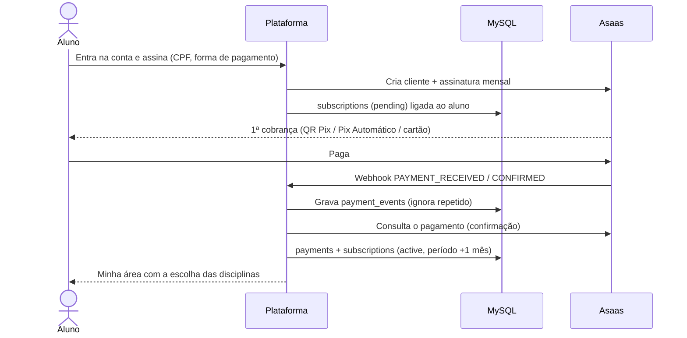
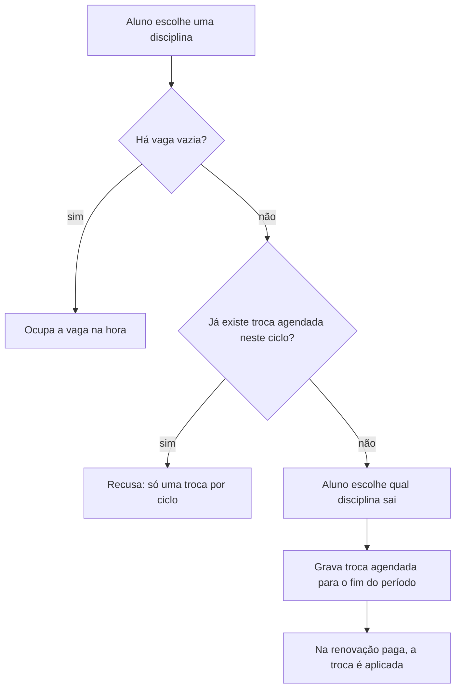

# 05 — Fluxos

## 1. Assinatura

A assinatura fica ligada à conta do aluno (RN01, RN02): ele entra com Google
ou com e-mail e senha antes de assinar. As disciplinas só são liberadas
depois que o servidor confirma o 1º pagamento na API do Asaas.

## 2. Renovação, atraso e cancelamento

| Evento do Asaas | Efeito |
| --- | --- |
| Pagamento recebido/confirmado | `payments` atualizado; `current_period_end` avança 1 ciclo; trocas agendadas são aplicadas |
| Cobrança vencida | Assinatura `past_due`; acesso continua até `current_period_end` |
| Período terminou sem pagamento | Vercel Cron marca `expired`; acesso encerra |
| Aluno cancela na minha área | A plataforma cancela a assinatura no Asaas; status `canceled`; acesso até `current_period_end` |
| Estorno | Assinatura `canceled` e `current_period_end` = agora |

## 3. Vagas e troca de disciplina

O aluno pode cancelar uma troca agendada antes da renovação.

## 4. Login do aluno

1. **Criar conta:** com Google, ou com nome, e-mail e senha em `/cadastrar`.
   No cadastro por senha, o aluno recebe um link de confirmação por e-mail e
   só entra com senha depois de confirmar (RN01).
2. **Entrar:** com Google, ou com e-mail e senha em `/entrar`. Google com um
   e-mail já cadastrado entra na mesma conta (RN01). Depois de entrar, o
   aluno vai para o **Início**, que para quem está logado é o painel dele
   (completo para quem assina, simples para quem não assina); só quem clicou
   em "Entrar" numa aula, disciplina ou atividade volta para ela
   (`loginReturnPath`, em `lib/safe-next.ts`).
3. **Limite de tentativas:** 5 erros a cada 15 min por IP e por e-mail (RNF03).
4. **Sessões:** cookie httpOnly assinado (Better Auth). Até 2 sessões por
   aluno: ao abrir a 3ª, a mais antiga é encerrada (RN08). Cada entrada fica
   em `access_logs`.
5. **Esqueci a senha:** link por e-mail válido por 1 hora e de uso único; ao
   redefinir, todas as sessões são encerradas (RF14).
6. **Visitante:** "Entrar como visitante" leva ao catálogo sem conta, com as
   aulas grátis abertas.
7. **Pelo painel:** o admin pode criar o aluno (o convite chega por e-mail
   para ele definir a senha), encerrar as sessões e enviar o link de
   redefinição (RF29).

## 5. Reprodução de uma aula

1. A página da aula pede um token a `/api/player-token`.
2. O servidor confere: aula grátis **ou** disciplina em `v_student_course_access`.
3. Vídeo Bunny → devolve URL assinada válida por 2 h. Link externo → devolve a URL.
4. O player mostra a marca d'água com o nome do aluno, que muda de posição.
5. A cada 15 s o player envia a posição para `/api/progress`; com 90% assistido, a aula fica concluída.

## 6. Material em PDF

Vale para PDFs enviados ao storage. Material por link externo (Google Drive,
OneDrive, Dropbox ou site) abre pelo próprio link, sem essa proteção; o
endereço só vai para a página de quem tem acesso.

1. A página pede o PDF a `/api/materials/view`.
2. O servidor confere o acesso e devolve uma URL assinada de curta duração.
3. O visualizador (pdf.js) desenha as páginas com marca d'água e sem botão de download.

## 7. Fórum

1. O assinante publica uma dúvida ou resposta → status `pending`.
2. O post aparece na fila de aprovação do admin.
3. Aprovado → `visible`; recusado → `hidden`.
4. Posts do admin já entram como `visible`.
