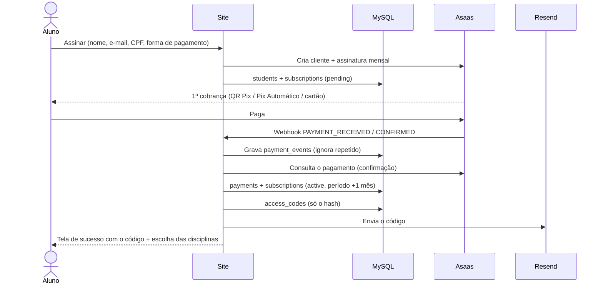
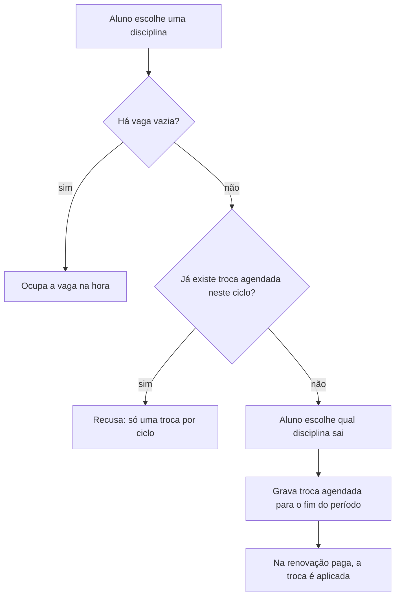

# 05 — Fluxos

## 1. Assinatura e código de acesso

O código só é gerado depois que o servidor confirma o 1º pagamento na API do
Asaas.

**Código:** 16 caracteres sorteados com `crypto.randomBytes` num alfabeto sem
caracteres ambíguos (sem 0/O, 1/I/L), exibidos como `XXXX-XXXX-XXXX-XXXX`.
São cerca de 10²⁴ combinações; com o limite de 5 tentativas a cada 15 min,
adivinhar é inviável. O banco guarda o SHA-256 do código sem hífens e em
maiúsculas.

## 2. Renovação, atraso e cancelamento

| Evento do Asaas | Efeito |
| --- | --- |
| Pagamento recebido/confirmado | `payments` atualizado; `current_period_end` avança 1 ciclo; trocas agendadas são aplicadas |
| Cobrança vencida | Assinatura `past_due`; acesso continua até `current_period_end` |
| Período terminou sem pagamento | Vercel Cron marca `expired`; acesso encerra |
| Aluno cancela na minha área | Site cancela a assinatura no Asaas; status `canceled`; acesso até `current_period_end` |
| Estorno | Assinatura `canceled` e `current_period_end` = agora |

## 3. Vagas e troca de disciplina

O aluno pode cancelar uma troca agendada antes da renovação.

## 4. Entrada com código

1. Aluno digita o código em `/entrar`.
2. O servidor normaliza (remove hífens, maiúsculas), calcula o SHA-256 e busca em `access_codes`.
3. Código ativo → cria `student_sessions`; se já houver 2 sessões, encerra a mais antiga.
4. Cookie httpOnly com o token da sessão. Tudo registrado em `access_logs`.

## 5. Reprodução de uma aula

1. A página da aula pede um token a `/api/player-token`.
2. O servidor confere: aula grátis **ou** disciplina em `v_student_course_access`.
3. Vídeo Bunny → devolve URL assinada válida por 2 h. Link externo → devolve a URL.
4. O player mostra a marca d'água (nome do aluno + 4 últimos caracteres do código), que muda de posição.
5. A cada 15 s o player envia a posição para `/api/progress`; com 90% assistido, a aula fica concluída.

## 6. Material em PDF

1. A página pede o PDF a `/api/materials/view`.
2. O servidor confere o acesso e devolve uma URL assinada de curta duração.
3. O visualizador (pdf.js) desenha as páginas com marca d'água e sem botão de download.

## 7. Fórum

1. O assinante publica uma dúvida ou resposta → status `pending`.
2. O post aparece na fila de aprovação do admin.
3. Aprovado → `visible`; recusado → `hidden`.
4. Posts do admin já entram como `visible`.
